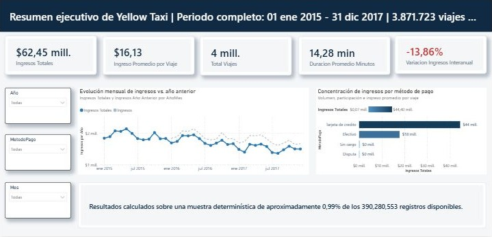
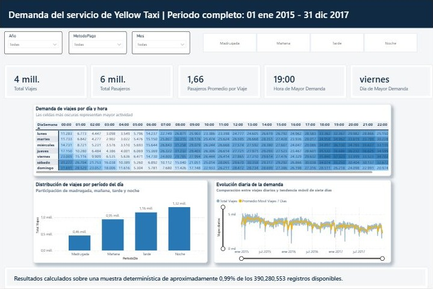
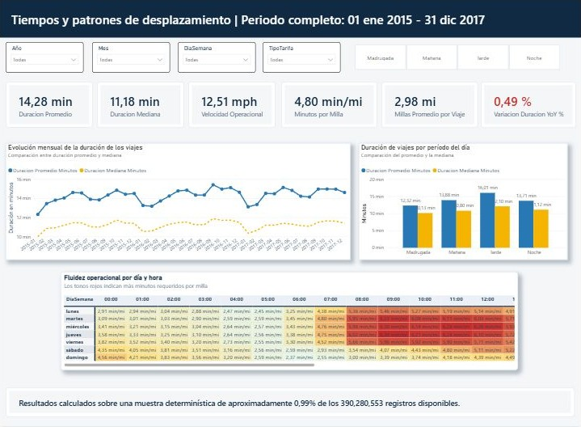
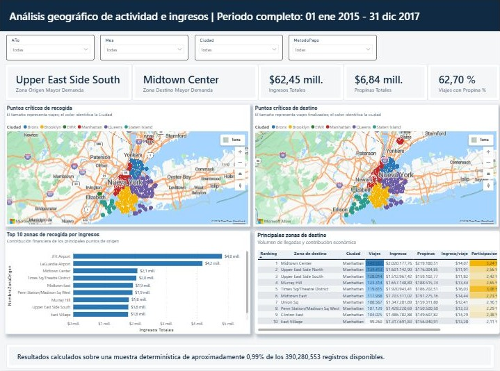
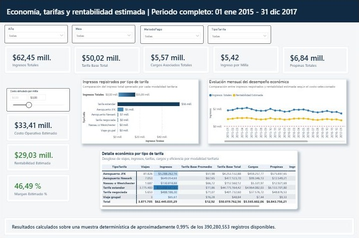
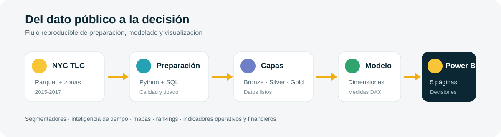

# NYC Taxi - Análisis operacional y rentabilidad con Power BI


Proyecto académico de Business Intelligence orientado a analizar el desempeño operacional y económico del servicio de taxis amarillos de Nueva York. El dashboard transforma datos públicos de NYC TLC en indicadores de ingresos, demanda, tiempos de viaje, movilidad geográfica y rentabilidad.

## Problema de negocio

La operación de taxis genera millones de registros de viajes, pero los datos aislados no permiten responder rápidamente preguntas como:

- ¿Cuándo se concentra la mayor demanda?
- ¿Qué zonas generan más viajes e ingresos?
- ¿Cómo cambian los ingresos frente al año anterior?
- ¿Qué métodos de pago y tipos de tarifa tienen mayor participación?
- ¿Cuál es la relación entre distancia, duración, costos y margen estimado?

El objetivo del proyecto es convertir esos registros en una herramienta visual para apoyar decisiones operativas, comerciales y de planificación.

## Dashboard

El informe contiene cinco páginas:

1. **Resumen Ejecutivo:** ingresos, viajes, duración promedio, ingreso promedio por viaje, variación interanual y participación por método de pago.
2. **Demanda del Servicio:** comportamiento por fecha, día de la semana y hora, incluyendo periodos de mayor demanda.
3. **Tiempos y Desplazamiento:** duración, distancia, velocidad operacional y minutos por milla.
4. **Análisis Geográfico:** zonas de origen y destino, mapas, rankings y concentración de viajes e ingresos.
5. **Economía y Rentabilidad:** tarifas, propinas, cargos asociados, costos estimados, ingreso por milla y margen estimado.

## Capturas reales del dashboard

Las imágenes siguientes corresponden a las cinco páginas del informe ejecutado en Power BI con el periodo completo 2015-2017.

### 01 · Resumen Ejecutivo



### 02 · Demanda del Servicio



### 03 · Tiempos y Desplazamiento



### 04 · Análisis Geográfico



### 05 · Economía y Rentabilidad



El archivo listo para abrir está en [`dashboard/NYC_Taxi_Analytics.pbix`](dashboard/NYC_Taxi_Analytics.pbix).

## Indicadores principales

| Categoría | Indicadores |
|---|---|
| Rendimiento general | Ingresos Totales, Total Viajes, Total Pasajeros, Ingreso Promedio por Viaje |
| Tendencia | Ingresos Año Anterior, Variación Ingresos YoY, Promedio Móvil 7 Días |
| Operación | Duración Promedio, Distancia Promedio, Velocidad Operacional, Minutos por Milla |
| Geografía | Zona Origen Mayor Demanda, Zona Destino Mayor Demanda, rankings y participación por zona |
| Rentabilidad | Propinas Totales, Tarifa Base Total, Cargos Asociados, Costo Operativo Estimado, Margen Estimado e Ingreso por Milla |

La explicación funcional de las medidas y del modelo se encuentra en [`docs/modelo-y-medidas.md`](docs/modelo-y-medidas.md).

## Flujo de datos



El proyecto utiliza una arquitectura analítica por capas:

- **Fuente:** archivos Parquet públicos de NYC Taxi & Limousine Commission.
- **Ingesta:** notebook de Python para cargar y preparar datos.
- **Procesamiento:** limpieza, tipado y controles de calidad.
- **Modelo:** estructura dimensional con fecha, hora, métodos de pago, tarifas y zonas.
- **Visualización:** Power BI, Power Query, DAX, segmentadores, gráficos y Azure Maps.

## Tecnologías

`Power BI` `Power Query` `DAX` `SQL Server` `Python` `Jupyter Notebook` `Modelado dimensional` `KPIs` `Azure Maps`

## Estructura del repositorio

```text
nyc-taxi-power-bi-analytics/
├── assets/                 # Portada, diagrama y capturas reales del dashboard
├── dashboard/              # Informe Power BI en formato PBIX
├── data/                   # Tabla pública de zonas de taxi
├── docs/                   # Documentación del modelo, medidas y fuentes
├── notebooks/              # Proceso de importación de datos
├── theme/                  # Tema visual personalizado de Power BI
└── README.md
```

## Cómo revisar el proyecto

1. Descarga o clona este repositorio.
2. Instala Power BI Desktop.
3. Abre `dashboard/NYC_Taxi_Analytics.pbix`.
4. Recorre las cinco páginas y utiliza los segmentadores para explorar periodos, zonas, métodos de pago y tipos de tarifa.

El conjunto completo de viajes no se incluye en GitHub por su tamaño. Puede descargarse desde la [fuente oficial de NYC TLC](https://www.nyc.gov/site/tlc/about/tlc-trip-record-data.page). El repositorio sí incluye `taxi_zone_lookup.csv`, utilizado para enriquecer el análisis geográfico.

## Fuente de datos

- [NYC Taxi & Limousine Commission - Trip Record Data](https://www.nyc.gov/site/tlc/about/tlc-trip-record-data.page)
- Periodo analizado: 2015-2017.
- Tipo de servicio: Yellow Taxi.
- Los datos son públicos y NYC TLC advierte que son suministrados por proveedores tecnológicos autorizados, por lo que pueden contener diferencias de calidad o completitud.

## Autor

**Byron Morales Martínez**

[GitHub](https://github.com/DreyMor16) · [LinkedIn](https://www.linkedin.com/in/byronmorales29)
